

  

<h1 align="center">LC Flujo</h1>

  <b>Control de efectivo para empresas constructoras</b> 
  Cuánto dinero hay, dónde está y en qué obra se gastó: sobres, caja chica, comprobantes, obras y materiales en un solo lugar, en la computadora o en el celular.

  
  
  
  
  
  

> [!NOTE]
> Sistema desarrollado para un cliente que lo usa todos los días. El código y sus datos son privados: **todas las capturas usan datos de prueba inventados**. Si quieres ver una demo, contáctame desde [mi perfil](https://github.com/luis16112004).

  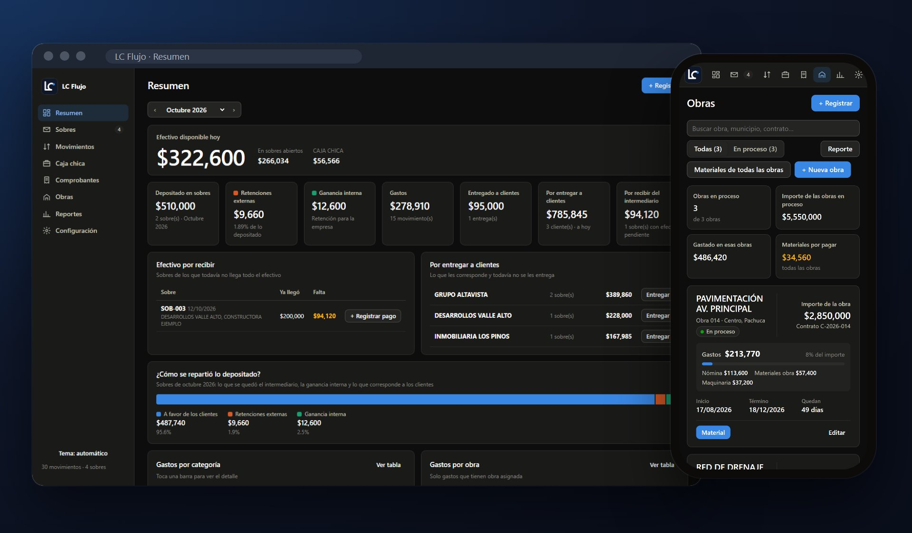

## ¿Qué problema resuelve?

El efectivo de la empresa se llevaba en varios archivos de Excel separados: uno para los sobres, otro para la caja chica y otros para cuadrar cada obra. Saber cuánto había en total, qué faltaba por recibir o cuánto llevaba gastado una obra tomaba horas y dependía de una sola persona.

LC Flujo junta todo en una app que hace las cuentas sola:

### El dinero

- **Efectivo disponible hoy:** lo que hay en sobres abiertos y en caja chica, en una sola cifra.
- **Sobres:** cada entrada de efectivo con sus pagos parciales:
  - Lo que ya llegó y lo que falta por recibir.
  - Lo que queda disponible.
  - Las comisiones, que se calculan solas.
- **Entregas a clientes:** cuánto le corresponde a cada cliente y de qué sobres sale lo que se le entrega.
- **Caja chica:**
  - Saldo inicial, entradas, salidas y saldo al cierre.
  - Un calendario que marca cuánto se movió cada día.
- **Comprobantes:** cada sobre y cada entrega tiene su comprobante. Se imprime o se guarda en PDF, en copia para el cliente y copia interna.

### Las obras

- **Cada obra con su contrato:** número, ubicación, fechas, importe y el PDF del contrato.
- **Gasto por obra:** nómina, materiales y maquinaria contra el importe del contrato, con los días que quedan para terminar.
- **Materiales:** compras con cantidad, unidad, precio y proveedor:
  - Lo pagado se registra solo como gasto.
  - Lo pendiente queda como "por pagar".

### Registro y reportes

- **Registrar desde un solo botón:** nuevo sobre, gasto, entrega, traspaso, ingreso, material u obra. Mientras se escribe el concepto, la app sugiere la categoría y la obra.
- **Gráficas:** gasto por categoría, por obra, por mes y por día.
- **Reportes con filtros:**
  - Movimientos y gastos agrupados.
  - Saldos por cliente.
  - Caja chica, obras y materiales.
  - Se descargan en Excel o se imprimen en PDF.

### En línea y sin internet

- **En línea:** se entra con usuario y contraseña desde la computadora o el celular, y se agrega a la pantalla de inicio como una app.
- **Sin internet:** la misma app corre en la computadora con doble clic y guarda todo en un Excel que se puede abrir directamente.
- **Respaldo completo:** todo se descarga en un Excel, con una hoja para cada tipo de dato.

## Capturas

<table>
  <tr>
    <td width="50%" valign="top"><b>Resumen</b> 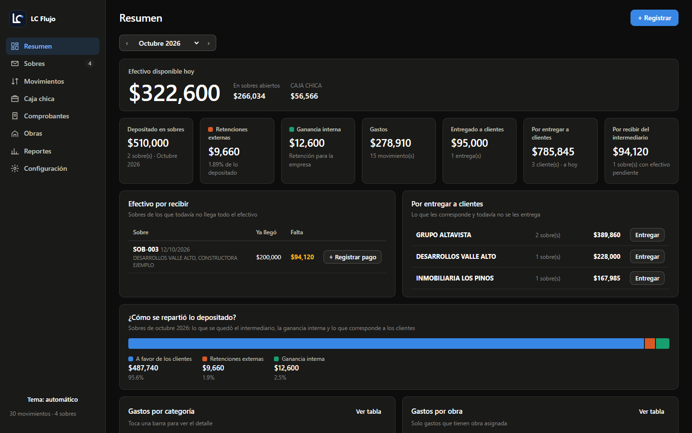</td>
    <td width="50%" valign="top"><b>Gráficas de gasto</b> 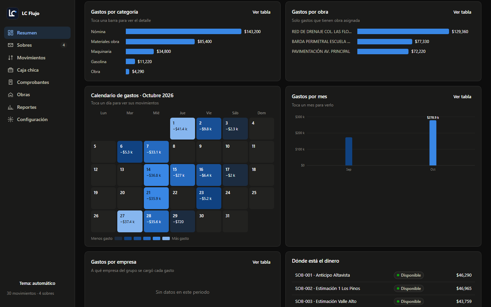</td>
  </tr>
  <tr>
    <td width="50%" valign="top"><b>Registrar</b> 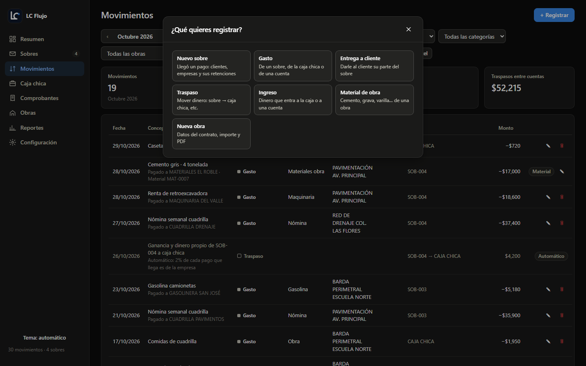</td>
    <td width="50%" valign="top"><b>Caja chica</b> 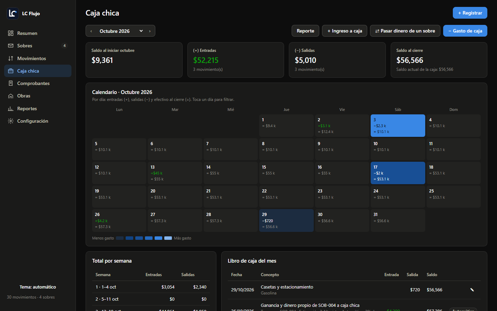</td>
  </tr>
  <tr>
    <td width="50%" valign="top"><b>Obras</b> 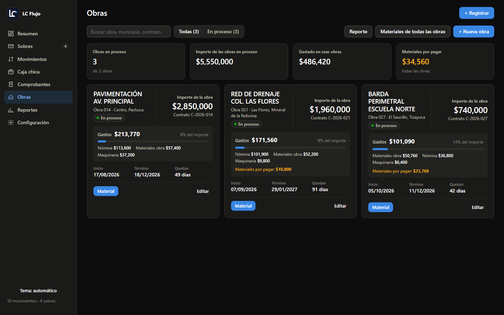</td>
    <td width="50%" valign="top"><b>Comprobantes</b> 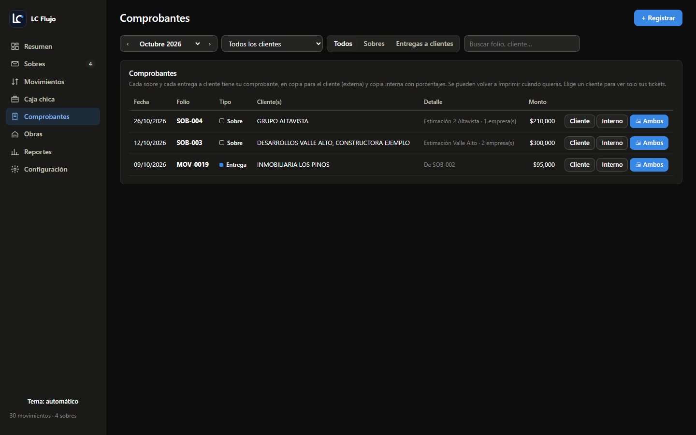</td>
  </tr>
  <tr>
    <td width="50%" valign="top"><b>Reportes</b> 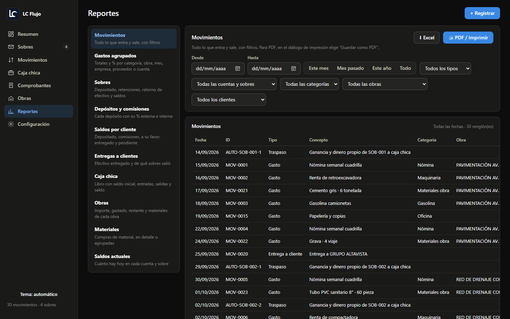</td>
    <td width="50%" valign="top"></td>
  </tr>
</table>

### En el celular

<table>
  <tr>
    <td width="33%" valign="top"><b>Resumen</b> 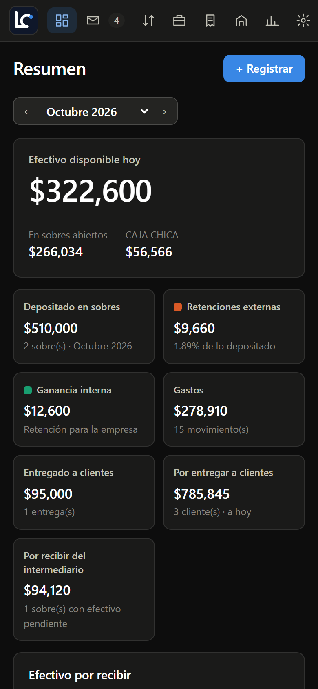</td>
    <td width="33%" valign="top"><b>Obras</b> 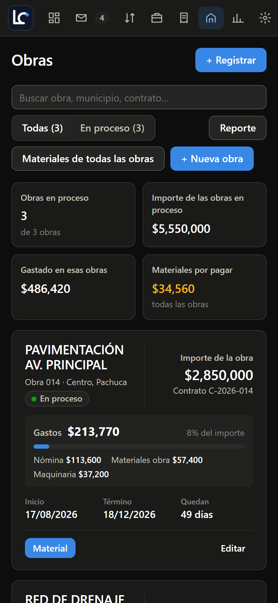</td>
    <td width="33%" valign="top"></td>
  </tr>
</table>

## Cómo está construido

  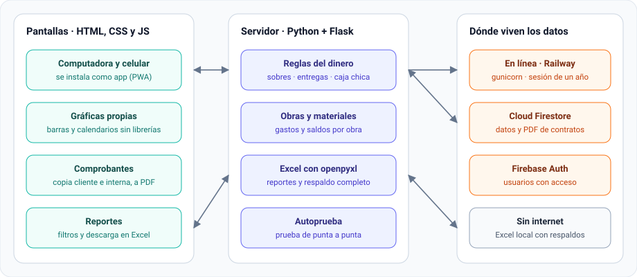

## Decisiones técnicas

- **Dos almacenes, una sola app.** El servidor trabaja con una interfaz de almacén: en la nube guarda en Firestore y en la computadora guarda en un Excel. Las pantallas y las reglas son las mismas en las dos versiones.
- **Las cuentas en un solo módulo.** Las comisiones, las entregas y los traspasos automáticos a caja chica se calculan en un módulo aparte, con las mismas reglas en línea y sin internet.
- **Autoprueba de la base de datos.** Desde la configuración se corre una prueba de punta a punta:
  - Captura datos de prueba en un área aparte.
  - Revisa que se lean igual desde la base.
  - Los borra al terminar, sin tocar los datos reales.
- **Respaldos automáticos.** En la versión de computadora se guarda una copia del Excel antes de modificarlo, como máximo una cada 10 minutos.
- **Sin librerías en el navegador.** Las pantallas están hechas en HTML, CSS y JavaScript puro, y las gráficas se dibujan a mano. La app carga rápido incluso en celulares sencillos.
- **Sesión segura en la nube.** Se entra con Firebase Authentication y solo los correos autorizados tienen acceso. La cookie de sesión es HttpOnly y estricta, y dura un año mientras se use.
- **Errores entendibles.** Los errores de configuración más comunes se explican en español, con el paso exacto para resolverlos.

## Tecnologías

| Área | Herramientas |
| --- | --- |
| Servidor | Python, Flask, gunicorn |
| Datos | Cloud Firestore, Excel con openpyxl |
| Sesión | Firebase Authentication |
| Interfaz | HTML, CSS y JavaScript sin dependencias, instalable como app (PWA) |
| Nube | Railway |

## Autor

**Luis David Casillas Gutiérrez** · [@luis16112004](https://github.com/luis16112004)
